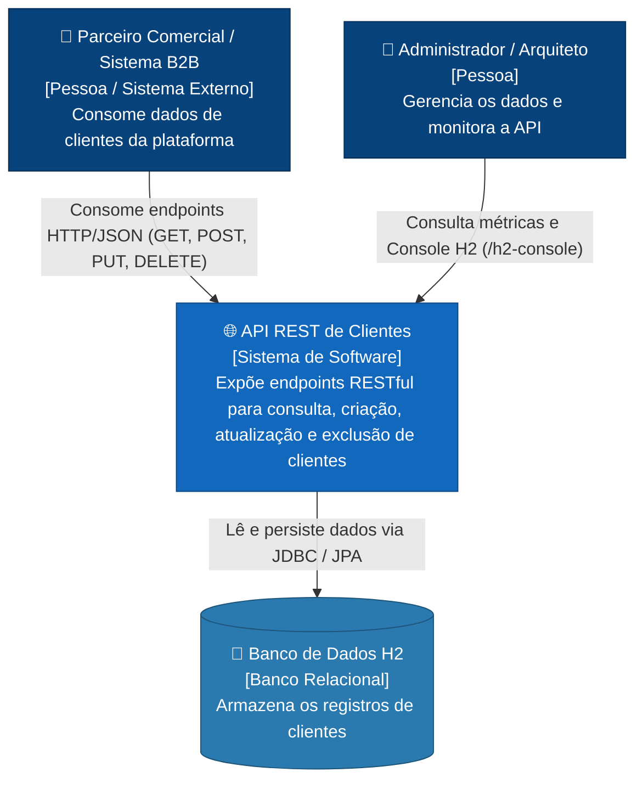
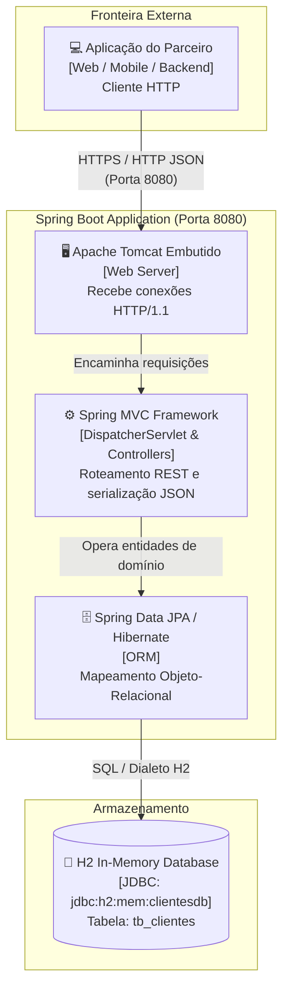
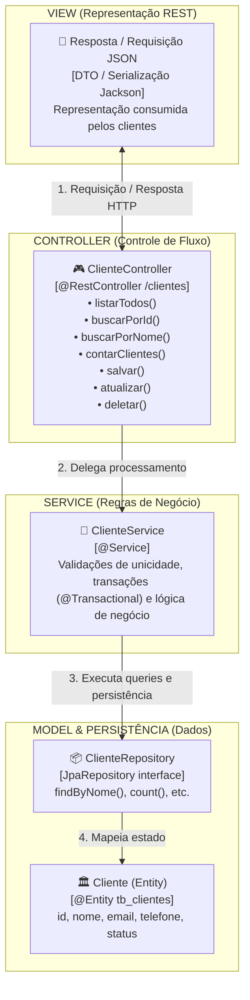
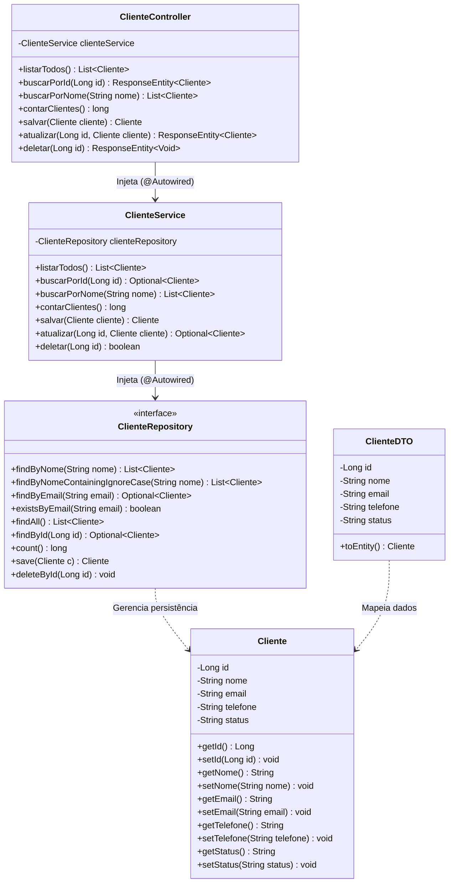
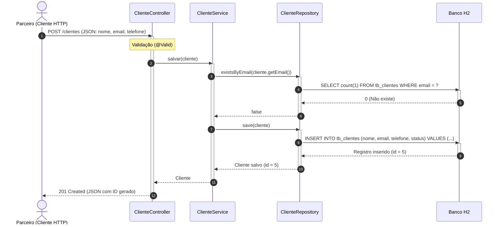

# Diagramas de Arquitetura de Software

Este documento apresenta a modelagem arquitetural completa da solução desenvolvida para disponibilizar dados de clientes aos parceiros de negócios, utilizando o padrão **MVC (Model-View-Controller)** sobre **Spring Boot (Java 17)** e **Spring Data JPA**.

---

## 1. C4 Model - Nível 1: Diagrama de Contexto (System Context)

Mostra os atores externos (Parceiros Comerciais) e como eles interagem com a API REST.

---

## 2. C4 Model - Nível 2: Diagrama de Contêineres (Container Diagram)

Detalha as tecnologias, protocolos e responsabilidades de cada contêiner de software.

---

## 3. C4 Model - Nível 3: Diagrama de Componentes (Padrão MVC)

Evidencia a divisão de responsabilidades estrita do padrão arquitetural **MVC**:

---

## 4. Diagrama de Classes UML

Apresenta a estrutura de classes, tipagem, métodos e associações do projeto:

---

## 5. Diagrama de Sequência UML (Ciclo de Vida de uma Requisição REST)

Exemplo: Cadastro de um novo cliente (`POST /clientes`).

